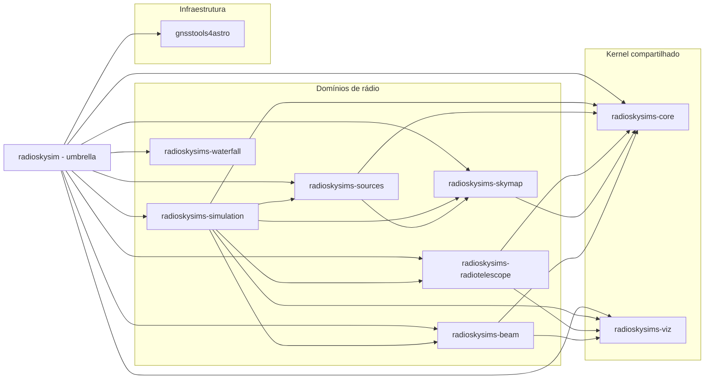
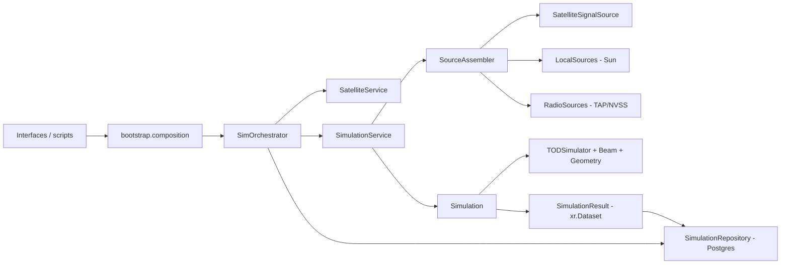

# Arquitetura — RadioSkySim

**Documento canônico de arquitetura.** Mantido continuamente durante o
desenvolvimento (veja `AGENTS.md`). Detalhes por tópico ficam em
`docs/architecture/` (bounded contexts, DI, entrypoints, dívidas técnicas).

---

## 1. Visão geral

O `RadioSkySim` é um pacote Python para **simulação e análise do céu de rádio**
visto por um radiotelescópio *single dish* em modo de trânsito (colaboração
BINGO). Ele modela beams, satélites, fontes locais, catálogos de rádio fontes e
sintetiza **TOD** (*Time Ordered Data*), além de gerar/analisar **mapas HEALPix**.

A arquitetura é **Hexagonal (Ports and Adapters)**:

```
interfaces → application → domain
bootstrap (composition root) ── monta ──▶ infrastructure (adapters)
infrastructure ──implementa──▶ ports (application/domain)
```

- **Domain** concentra entidades, value objects e regras de negócio (não deve
  depender de infrastructure/application).
- **Application** orquestra casos de uso e depende de *ports* (contratos).
- **Infrastructure** provê adapters concretos (PostgreSQL, arquivos, providers
  externos: Skyfield, SpaceTrack, astroquery/TAP, Healpy, PySM3, HiPS).
- **Interfaces** são entrypoints (API/CLI/GUI) que chamam o composition root.
- **Bootstrap** é o *composition root* oficial (DI), centralizando a montagem de
  dependências concretas (`src/radioskysims/bootstrap/`).

### 1.1 Ecossistema de pacotes (uv workspace)

Desde o desacoplamento (2026-08), o monólito foi fatiado em **9 distribuições**
próprias em `packages/*` (submódulos git), gerenciadas por **uv workspace**
(`[tool.uv.workspace] members = ["packages/*"]`). O pacote raiz `radioskysim`
virou **meta-pacote fino** (composition root + CLI/GUI + extras seletivos).



- `radioskysims-core` (kernel: config, db, logging, paths, monitor, progress e
  domínio `common`/`geometry`/`tracks`) e `radioskysims-viz`
  (`PanelApplication`, `VisualizerPort`) não dependem de domínios de rádio.
- `radioskysims-waterfall` é **autônomo** (não depende de `core`/`viz` na
  implementação atual) — integração com `simulation` via porta, sem dependência
  rígida.
- Nomenclatura de imports própria por pacote (`radioskysims_core`, ...), sem
  namespace PEP 420 único. A partir da Fase 7 não há mais shims de
  compatibilidade em `src/radioskysims/`.

## 2. Bounded contexts

| Context | Responsabilidade | Ports principais |
|---|---|---|
| **Beam** | Carregar/avaliar padrões de feixe | `BeamLoaderPort`, `BeamEvaluatorPort` |
| **Satellite** | Órbitas (TLE), seleção e tracks | `SatelliteRepositoryPort`, `GeometryProviderPort` |
| **LocalSources** | Fontes locais (Sol) e fluxo | `LocalSourcesPort` |
| **RadioSources** | Catálogos e fluxo espectral (TAP) | `RadioSourcesCatalogPort`, `RadioSourcesFluxPort`, `CatalogIngestPort` |
| **TOD** | Síntese de Time Ordered Data | `TODSimulator` |
| **SkyMap** | Mapas HEALPix (geração/transformação/análise) | `SkyMapGeneratorPort`, `SkyMapAnalyzerPort`, `SkyMapIOPort` |
| **Simulation** | Orquestração end-to-end | agrega os ports acima; `SimulationRepositoryPort` |
| **Waterfall** | Ferramentas de waterfall (tempo × frequência) | `WaterfallLoaderPort`, `WaterfallStoragePort` |

Ports da aplicação em `src/radioskysims/application/ports/`:
`beam.py`, `geometry.py`, `localsources.py`, `radiosources.py`, `satellite.py`,
`simulations.py`, `skymap.py`.

## 3. Fluxo principal (pipeline de simulação de TOD)



1. Entrypoints/scripts chamam `bootstrap.composition`.
2. `bootstrap.builders` monta dependências concretas (config, logging, DB,
   repositórios, serviços).
3. `SimOrchestrator.run_simulation()` orquestra a simulação.
4. `SimulationService`/`SourceAssembler` monta fontes (satélites, Sol, rádio).
5. `Simulation` executa a pipeline geométria → beam → TOD → dataset.
6. O resultado é um `SimulationResult` (xarray, lazy/dask).
7. `SimulationOrchestratorResult` consolida e permite persistir o resumo no
   Postgres (`SimulationRepository`) e o dataset em HDF5/Zarr.

Processamento com `use_processor=True` usa `ResourceAwareProcessor` para
particionar fontes em batches com controle de memória e scheduler dask
(`threads` | `synchronous` | `distributed`).

### 3.1 Contrato operacional de events

- O dataset principal (`SimulationResult.dataset`) permanece lazy.
- `events`/`transits` são produtos derivados materializados incrementalmente por chunks temporais.
- Não há `compute` global do dataset completo nessa extração; apenas os chunks necessários são computados.
- O retorno de `events` é cacheado após a primeira extração.
- Esta é uma decisão deliberada de engenharia para limitar memória, e não laziness ponta a ponta.

## 4. Unidades e convenções

| Grandeza | Convenção |
|---|---|
| Frequência | MHz (usuário) |
| Ângulos | graus (usuário); radianos (interno) |
| Tempo interno | MJD/JD (UTC); entrada ISO |
| Intervalos | segundos |
| Temperatura de antena | Kelvin |
| Fluxo | Jy |

## 5. Persistência e dados

- **PostgreSQL** (SQLModel/Pydantic) via `infrastructure/db/`; container em
  `docker/postgresql/` (compose: postgres + adminer + backup).
- Dados locais em `data/` (`data/aux`, `data/temp`, `data/DB`, `data/catalog`,
  `data/hips`, `data/TOD`, `data/MAPS`).
- Datasets persistidos em **HDF5** (engine `h5netcdf`) ou **Zarr**, com registro
  em banco via SQLModel.
- Cálculos astronômicos via `skyfield_provider` (tracks, ângulos, eventos).
- Downloads preferencialmente com `httpx` assíncrono.

## 6. Composition root (DI)

`src/radioskysims/bootstrap/`:
- `builders.py` — `build_configuration`, `build_logging`, `build_database`,
  `build_repositories`, `build_domain_components`, `build_services`,
  `build_local_sources_service`.
- `composition.py` — `create_sim_orchestrator(telescope=...)`,
  `create_simulation_context(...)`.

Fluxo de inicialização (TOD viewer):
`scripts/start_service.py` → `create_sim_orchestrator("default")` →
`create_simulation_context` → builders → `SimOrchestrator.run()` → `TODPanel`.

## 7. Estado arquitetural atual e dívidas técnicas

Resumo da auditoria (`docs/architecture/current_architecture.md`,
`module_dependencies.md`):

**O que está consolidado**
- Layout hexagonal com ports em `application/ports/` e composition root.
- Módulos recentes seguem a separação (ex.: `simulation` com port
  `SimulationRepositoryPort` + adapter `SimulationRepository`).
- Infraestrutura → Domain: esperado (adapters implementam contratos de domínio).

**Dívidas / riscos**
- `application → infrastructure` e `domain → infrastructure` ainda ocorrem em
  módulos centrais (ex.: `sim_orchestrator`, `simulation_service`, `domain/signal`,
  `domain/tracks`, `domain/skymap`).
- `domain/satellite/main.py` mistura concern de API web no domínio.
- Dois caminhos de loaders de beam (`infrastructure/files/*` e
  `infrastructure/beams/loaders/*`) e dois namespaces de beam
  (`radioskysims/beam` legado vs `domain/beam`).
- `domain/common` concentrado (risco de virar "god/common").
- **Segurança**: `settings.toml` contém credenciais reais do SpaceTrack
  versionadas — mover para `credentials.env`/variáveis de ambiente.

Detalhes: `docs/architecture/technical_debt.md` e `refactoring_roadmap.md`.

## 8. Diagramas

- Diagrama do **ecossistema de pacotes** (uv workspace) inline na §1.1 acima.
- `docs/diagrams/uml_high_level.mmd` — visão de alto nível (camadas/pacotes).
- `docs/diagrams/uml_detailed.mmd` — classes principais do domínio.
- `docs/diagrams/usecase_*.mmd` — casos de uso (TOD, SkyMap, Satellite, Beam).
- `docs/diagrams/architecture.mmd` — pacotes/camadas (visão simplificada).
- `docs/diagrams/uml_complete_*.mmd` — visão completa (arquitetura, bounded
  contexts, classes detalhadas, sequência TOD GNSS).
- `docs/diagrams/classes_and_sequence_*.mmd` — classes e sequências (TOD GNSS,
  fluxo satellite→tracks→signal→assembled).

## 9. Referências

- `docs/architecture/current_architecture.md` — auditoria atual
- `docs/architecture/target_architecture.md` — arquitetura alvo (Fase 2)
- `docs/architecture/bounded_contexts.md` — contexts e contratos
- `docs/architecture/dependency_injection.md` — DI
- `docs/architecture/entrypoints.md` — entrypoints oficiais
- `docs/architecture/module_dependencies.md` — análise de dependências
