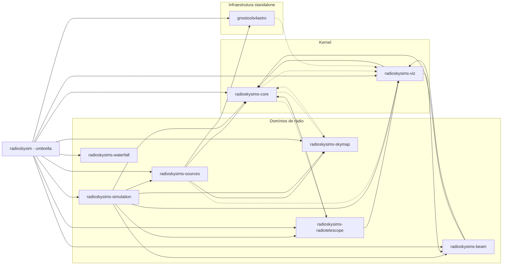
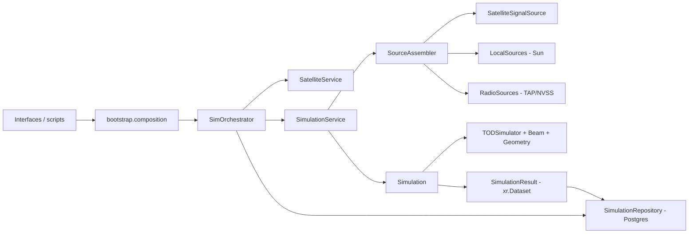

# Arquitetura — RadioSkySim

**Documento canônico de arquitetura.** Mantido continuamente durante o
desenvolvimento (veja `AGENTS.md`). Detalhes por tópico ficam em
`docs/architecture/` (bounded contexts, DI, entrypoints, dívidas técnicas).

**Última revisão:** 2026-11-05 (sincronizado com a auditoria consolidada de
novembro — [`november_2026_audit_report.md`](../audits/november_2026_audit_report.md)
e [`frentes_status_consolidado.md`](../audits/frentes_status_consolidado.md);
métricas históricas em [`metricas_tecnicas_2026.md`](../audits/metricas_tecnicas_2026.md)).

---

## 1. Visão geral

O `RadioSkySim` é um pacote Python para **simulação e análise do céu de rádio**
visto por um radiotelescópio *single dish* em modo de trânsito (colaboração
BINGO). Ele modela beams, satélites, fontes locais, catálogos de rádio fontes e
sintetiza **TOD** (*Time Ordered Data*), além de gerar/analisar **mapas HEALPix**.

A arquitetura é **Hexagonal (Ports and Adapters)**:

```
interfaces → application → domain
bootstrap (composition root) ── monta ──▶ infrastructure (adapters)
infrastructure ──implementa──▶ ports (application/domain)
```

- **Domain** concentra entidades, value objects e regras de negócio (não deve
  depender de infrastructure/application).
- **Application** orquestra casos de uso e depende de *ports* (contratos).
- **Infrastructure** provê adapters concretos (PostgreSQL, arquivos, providers
  externos: Skyfield, SpaceTrack, astroquery/TAP, Healpy, PySM3, HiPS).
- **Interfaces** são entrypoints (API/CLI/GUI) que chamam o composition root.
- **Bootstrap** é o *composition root* oficial (DI), centralizando a montagem de
  dependências concretas (`src/radioskysims/bootstrap/`).

### 1.1 Ecossistema de pacotes (uv workspace)

Desde o desacoplamento (2026-08), o monólito foi fatiado em **9 distribuições**
próprias em `packages/*` (submódulos git), gerenciadas por **uv workspace**
(`[tool.uv.workspace] members = ["packages/*"]`). O pacote raiz `radioskysim`
virou **meta-pacote fino** (composition root + CLI/GUI + extras seletivos).



- `radioskysims-core` (kernel: config, db, logging, paths, monitor, progress e
  domínio `common`/`geometry`/`tracks`) e `radioskysims-viz`
  (`PanelApplication`, `VisualizerPort`) foram desenhados como kernel, mas na
  prática **não são puros**: `core` importa `radiotelescope`/`skymap`/`viz`
  (`config_loader`, `exceptions`, `observer` lazy) e `viz` importa `core`/`beam`
  — violações representadas pelas setas tracejadas acima (ver
  `module_dependencies.md`).
- `radioskysims-waterfall` é **autônomo** (não depende de `core`/`viz` na
  implementação atual) — integração com `simulation` via porta, sem dependência
  rígida.
- Nomenclatura de imports própria por pacote (`radioskysims_core`, ...), sem
  namespace PEP 420 único. A partir da Fase 7 não há mais shims de
  compatibilidade em `src/radioskysims/`.

## 2. Bounded contexts

| Context | Responsabilidade | Ports principais |
|---|---|---|
| **Beam** | Carregar/avaliar padrões de feixe | `BeamLoaderPort`, `BeamEvaluatorPort` |
| **Satellite** | Órbitas (TLE), seleção e tracks | `SatelliteRepositoryPort`, `GeometryProviderPort` |
| **LocalSources** | Fontes locais (Sol) e fluxo | `LocalSourcesPort` |
| **RadioSources** | Catálogos e fluxo espectral (TAP) | `RadioSourcesCatalogPort`, `RadioSourcesFluxPort`, `CatalogIngestPort` |
| **TOD** | Síntese de Time Ordered Data | `TODSimulator` |
| **SkyMap** | Mapas HEALPix (geração/transformação/análise) | `SkyMapGeneratorPort`, `SkyMapAnalyzerPort`, `SkyMapIOPort` |
| **Simulation** | Orquestração end-to-end | agrega os ports acima; `SimulationRepositoryPort` |
| **Waterfall** | Ferramentas de waterfall (tempo × frequência) | `WaterfallLoaderPort`, `WaterfallStoragePort` |

Ports da aplicação em `src/radioskysims/application/ports/`:
`beam.py`, `geometry.py`, `localsources.py`, `radiosources.py`, `satellite.py`,
`simulations.py`, `skymap.py`.

## 3. Fluxo principal (pipeline de simulação de TOD)



1. Entrypoints/scripts chamam `bootstrap.composition`.
2. `bootstrap.builders` monta dependências concretas (config, logging, DB,
   repositórios, serviços).
3. `SimOrchestrator.run_simulation()` orquestra a simulação.
4. `SimulationService`/`SourceAssembler` monta fontes (satélites, Sol, rádio).
5. `Simulation` executa a pipeline geométria → beam → TOD → dataset.
6. O resultado é um `SimulationResult` (xarray, lazy/dask).
7. `SimulationOrchestratorResult` consolida e permite persistir o resumo no
   Postgres (`SimulationRepository`) e o dataset em HDF5/Zarr.

Processamento com `use_processor=True` usa `ResourceAwareProcessor` para
particionar fontes em batches com controle de memória e scheduler dask
(`threads` | `synchronous` | `distributed`).

### 3.1 Contrato operacional de events

- O dataset principal (`SimulationResult.dataset`) permanece lazy.
- `events`/`transits` são produtos derivados materializados incrementalmente por chunks temporais.
- Não há `compute` global do dataset completo nessa extração; apenas os chunks necessários são computados.
- O retorno de `events` é cacheado após a primeira extração.
- Esta é uma decisão deliberada de engenharia para limitar memória, e não laziness ponta a ponta.

## 4. Unidades e convenções

| Grandeza | Convenção |
|---|---|
| Frequência | MHz (usuário) |
| Ângulos | graus (usuário); radianos (interno) |
| Tempo interno | MJD/JD (UTC); entrada ISO |
| Intervalos | segundos |
| Temperatura de antena | Kelvin |
| Fluxo | Jy |

## 5. Persistência e dados

- **PostgreSQL** (SQLModel/Pydantic) via `infrastructure/db/`; container em
  `docker/postgresql/` (compose: postgres + adminer + backup).
- Dados locais em `data/` (`data/aux`, `data/temp`, `data/DB`, `data/catalog`,
  `data/hips`, `data/TOD`, `data/MAPS`).
- Datasets persistidos em **HDF5** (engine `h5netcdf`) ou **Zarr**, com registro
  em banco via SQLModel.
- Cálculos astronômicos via `skyfield_provider` (tracks, ângulos, eventos).
- Downloads preferencialmente com `httpx` assíncrono.

## 6. Composition root (DI)

**Atualização (Fase 5 do desacoplamento):** `src/radioskysims/bootstrap/` ficou
**fino** e passou a delegar para os pacotes (strategy pattern), quebrando o
ciclo lazy `sim_orchestrator ↔ composition` que existia quando tudo vivia no
umbrella:

- `builders.py` — re-exporta builders concretos dos pacotes:
  `build_database`/`build_logging` (`radioskysims-core`),
  `_load_beam_from_csv` (`radioskysims-beam`),
  `build_configuration` (`radioskysims-radiotelescope`),
  `build_domain_components`/`build_services`/
  `build_simulation_context_dependencies`/`build_skymap_components`
  (`radioskysims-simulation`),
  `build_cosmology_components`/`build_local_sources_service`/
  `build_radiosources_use_cases`/`build_repositories` (`radioskysims-sources`).
- `composition.py` — reexporta `create_sim_orchestrator(telescope=...)` e
  `create_simulation_context(...)` de
  `radioskysims_simulation.bootstrap.composition`; **não contém lógica
  própria**.

Fluxo de inicialização (TOD viewer):
`scripts/start_service.py` → `create_sim_orchestrator("default")` →
`create_simulation_context` (em `radioskysims_simulation.bootstrap`) →
builders dos pacotes → `SimOrchestrator.run()` → `TODPanel`.

## 7. Estado arquitetural atual e dívidas técnicas

**Atualização 2026-11-05** — auditoria completa em
[`november_2026_audit_report.md`](../audits/november_2026_audit_report.md),
com detalhe tático por pacote em [`module_dependencies.md`](module_dependencies.md)
e histórico quantitativo em [`metricas_tecnicas_2026.md`](../audits/metricas_tecnicas_2026.md).

### 7.1 Indicadores (nov/2026)

| Métrica | Ago/2026 | Nov/2026 | Tendência |
|---|---:|---:|---|
| Arquivos Python (produção) | 260 | 669 | ↑ +157% |
| Linhas de produção | 36.950 | 91.340 | ↑ +147% |
| Funções de teste | ~950 | 253+¹ | ↓¹ |
| Lint (violações, ruleset ativo) | 1.062 | ~10 | ↓ -99% |
| Formatação (% OK) | 56% | 87% | ↑ |
| Type hints (cobertura) | 55% | 65% | ↑ (meta 80% em dez) |
| Cobertura de testes (global) | 64% | ~64% | ✓ estável |
| Branches WIP | 4 | 3 | ✓ controlado |

Aderência **Hexagonal + DDD**: ~85%. Grafo de dependências **entre pacotes**
permanece acíclico e coerente (kernel → domínios → orquestração → umbrella),
sem violação circular.

> ¹ A contagem de novembro (`253+`) cobre apenas `tests/` (meta-pacote);
> incluindo `packages/*/tests` o total é ~1.500 funções (ver
> [`metricas_tecnicas_2026.md`](../audits/metricas_tecnicas_2026.md)).

### 7.2 Frentes de trabalho (nov–dez/2026)

| Frente | Objetivo | Status |
|---|---|---|
| **F1 — UX entrypoints** | Ruído no startup, logging/progress, docs de uso | 50% (R1–R3 done; R4–R6 e L1–L3 em andamento) |
| **F2 — Dívida técnica** | DDD (logging/providers), refactoring de orquestração, lint/format/type hints | 30% (diagnóstico completo; refactor iniciando) |
| **F3 — Validações científicas** | HI, mapmaking, TOD 24h, satélites | 60% (HI e mapmaking concluídos; TOD 24h e satélites pendentes) |

Detalhamento, DoD por frente e timeline semana a semana:
[`frentes_status_consolidado.md`](../audits/frentes_status_consolidado.md) e
[`CHECKLIST_NOV_DEC_2026.md`](../audits/CHECKLIST_NOV_DEC_2026.md).

### 7.3 O que está consolidado

- Layout hexagonal com ports em `application/ports/` (por pacote) e
  composition root fino no umbrella (delega para os pacotes, §6).
- Grafo de dependências **entre pacotes** é acíclico e coerente (kernel →
  domínios → orquestração → umbrella); nenhuma violação circular encontrada.
- Itens historicamente resolvidos: **não há mais** `domain/satellite/main.py`
  (concern de API web no domínio removido); **não há mais** duplicação de
  loaders de beam (`infrastructure/files/*` foi eliminado, resta só
  `infrastructure/beams/loaders/*`); **não há mais** namespace legado
  `radioskysims/beam`; **credenciais do SpaceTrack não são mais versionadas**
  em `settings.toml` (comentário explícito aponta para `credentials.env`,
  gitignored).

### 7.4 Dívidas / riscos ainda presentes

(ver `module_dependencies.md` para detalhe por pacote)

- **Logging direto em `domain`** — `domain/*/services.py` usam logger
  (~8–10 imports), violando a pureza do domínio. Novo item de prioridade
  alta da auditoria de novembro; ação F2a: mover para application.
- **Orquestração concentrada** — `sim_orchestrator.py` (~1.623 linhas) e
  `simulation.py` (~1.573 linhas) acumulam application + infrastructure em
  `radioskysims-simulation`; maior risco de manutenção do monorepo. Ação F2b:
  decompor em casos de uso (com `DESIGN.md`).
- `application → infrastructure` e `domain → infrastructure` ainda ocorrem,
  concentrados em `radioskysims-simulation` (`sim_orchestrator.py`,
  `simulation.py`) e `radioskysims-sources` (`satelliterepository.py`,
  `selector.py`, `catalog_services.py` e afins).
- `GeometryProviderPort` definido em `application.ports.geometry` mas
  implementado por provider em `domain` (`radioskysims-core`) — inversão de
  dependência que destoa da regra estrita "domain não depende de
  application". Candidato a mover o contrato para `domain.geometry`.
- `radioskysims_core.domain.common.models` concentrado (risco de virar
  módulo "god/common"); 654 linhas e crescendo conforme mais pacotes
  dependem dele.
- `radioskysims-skymap` e `radioskysims-radiotelescope` são hoje os únicos
  pacotes **sem** violação de camada detectada — referência de estrutura para
  os demais.

Detalhes quantitativos (linhas, lint, formatação, docstrings):
[`code_quality.md`](code_quality.md) e
[`metricas_tecnicas_2026.md`](../audits/metricas_tecnicas_2026.md).

## 8. Diagramas

**Atualização 2026-09-01**: diagramas em `docs/diagrams/` revisados para a
estrutura pós-desacoplamento (9 pacotes). Ver detalhamento e histórico em
[`relatorio_set_2026_v2.md §12`](relatorio_set_2026_v2.md).

- Diagrama do **ecossistema de pacotes** (uv workspace) inline na §1.1 acima.
- `docs/diagrams/architecture.mmd` — visão suite-level (grafo de dependências
  entre os 9 pacotes + umbrella).
- `docs/diagrams/uml_high_level.mmd` — visão de alto nível (entrypoints →
  bootstrap → pacotes → persistência).
- `docs/diagrams/uml_packages_detailed.mmd` — **novo**: "Individual
  Applications" — camadas hexagonais internas (domain/application/ports/
  infrastructure/bootstrap) de cada um dos 9 pacotes + umbrella, com as
  dependências inter-pacote resumidas.
- `docs/diagrams/uml_detailed.mmd` — classes principais do domínio (visão
  lógica por bounded context, independente de pacote).
- `docs/diagrams/usecase_*.mmd` — casos de uso (TOD, SkyMap, Satellite, Beam),
  cada um com nota indicando o pacote atual.
- `docs/diagrams/uml_complete_*.mmd` — visão completa (arquitetura, bounded
  contexts, classes detalhadas, sequência TOD GNSS), com notas de mapeamento
  para pacotes adicionadas nesta rodada.
- `docs/diagrams/usecase_*.mmd` e `classes_and_sequence_*.mmd` correspondem
  aos fluxos dos notebooks — ver [`notebooks_usecases.md`](notebooks_usecases.md)
  para o mapeamento explícito notebook → sequence diagram.
- `docs/diagrams/classes_and_sequence_*.mmd` — classes e sequências (TOD GNSS,
  fluxo satellite→tracks→signal→assembled).

## 9. Referências

Auditoria corrente (novembro/2026):

- `docs/audits/november_2026_audit_report.md` — auditoria técnica completa (novembro/2026)
- `docs/audits/frentes_status_consolidado.md` — status F1/F2/F3 + DoD + timeline
- `docs/audits/metricas_tecnicas_2026.md` — histórico de métricas (ago–nov/2026)
- `docs/audits/CHECKLIST_NOV_DEC_2026.md` — plano operacional semana a semana
- `docs/audits/AUDIT_SUMMARY_NOV2026.txt` — sumário visual (5 min)
- `.prompts/barosil.md` — documento-mestre de trabalho (todo + snapshot)

Auditorias temáticas (set–out/2026):

- `docs/audits/neutral_hydrogen_physical_feature_audit.md` — validação de HI (concluída)
- `docs/audits/mapmaking_physical_feature_audit.md` / `mapmaking_binned_scaling.md` — mapmaking (concluído)
- `docs/audits/tod_performance_audit_report.md` — performance TOD 1h (concluída)
- `docs/audits/engineering_audit_report.md` — engenharia (agosto; parcialmente superado por novembro)

Documentos de arquitetura (por tópico):

- `docs/architecture/relatorio_set_2026_v2.md` — relatório de auditoria completo (setembro/2026)
- `docs/architecture/bounded_contexts.md` — contexts e contratos
- `docs/architecture/entrypoints.md` — entrypoints oficiais
- `docs/architecture/module_dependencies.md` — análise de dependências
- `docs/architecture/technical_debt.md` — dívida técnica histórica
- `docs/architecture/code_quality.md` — métricas de lint, formatação, docstrings e tipagem
- `docs/architecture/performance.md` — análise de eficiência e gargalos
- `docs/architecture/logging.md` — convenções de logging estruturado
- `docs/architecture/persistence.md` — persistência (PostgreSQL, HDF5/Zarr)
