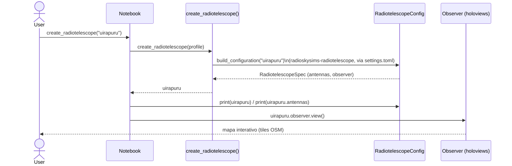
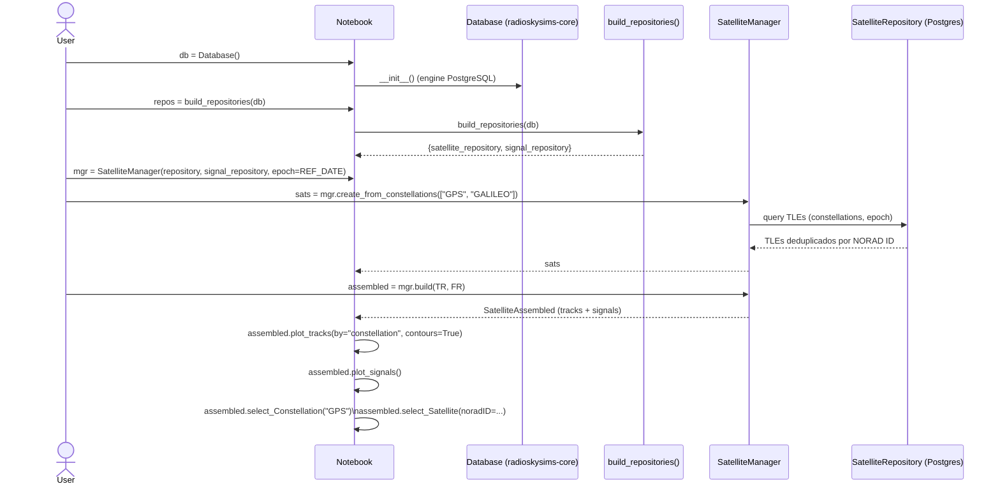
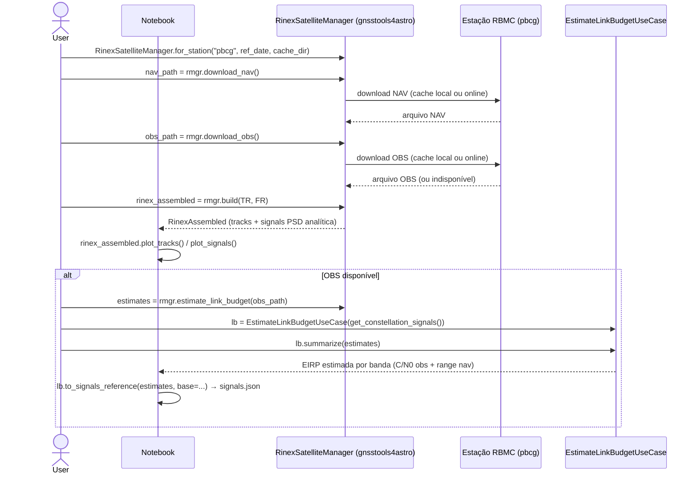
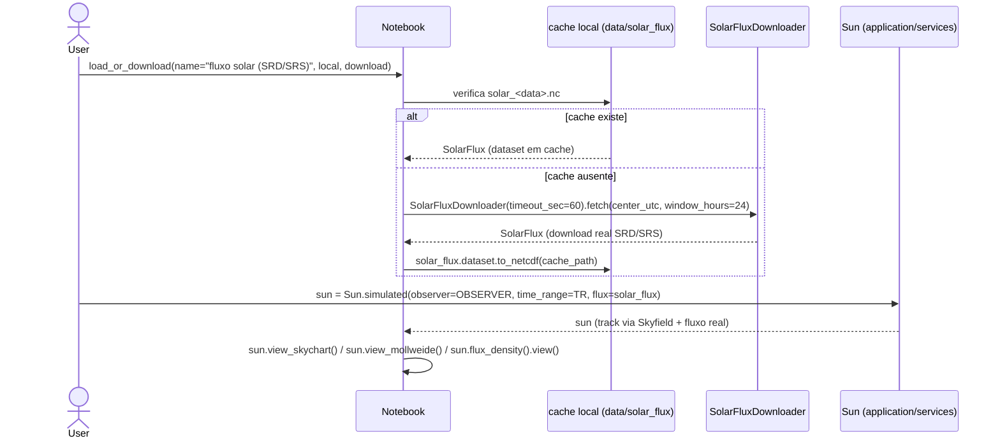
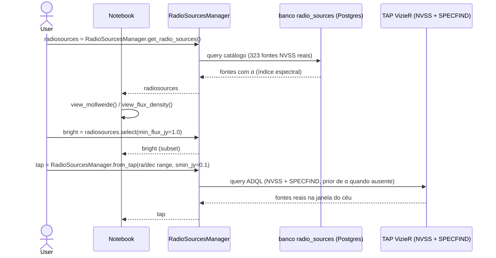
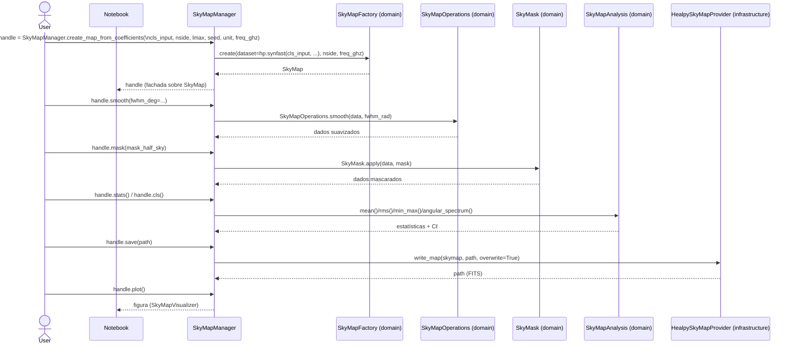
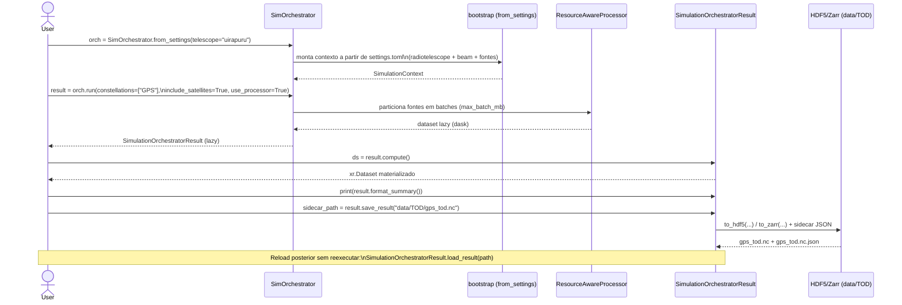

# Casos de Uso dos Notebooks — Sequence Diagrams

**Data:** 2026-09-01

Este documento mapeia explicitamente cada notebook de exemplo
(`notebooks/`) para diagramas de sequência (Mermaid) que refletem as
chamadas reais de API observadas no código das células. Complementa
[`architecture.md §8`](architecture.md) e os diagramas legados em
`docs/diagrams/usecase_*.mmd` (que descrevem os *casos de uso* em nível de
domínio, não a sequência de chamadas do notebook).

| Notebook | Seção | Diagrama |
|---|---|---|
| `00_examples.ipynb` | §2 Radiotelescope & Beam | [§1](#1-radiotelescope--beam-00_examplesipynb-2) |
| `00_examples.ipynb` | §3 Satélites via TLE | [§2](#2-satélites-via-tle-00_examplesipynb-3) |
| `00_examples.ipynb` | §3 Satélites via RINEX | [§3](#3-satélites-via-rinex-00_examplesipynb-3) |
| `00_examples.ipynb` | §4 Local Sources (Sun) | [§4](#4-local-sources-sol-00_examplesipynb-4) |
| `00_examples.ipynb` | §5 Radio Sources (NVSS) | [§5](#5-radio-sources-nvss-00_examplesipynb-5) |
| `01_maps.ipynb` | §7 `SkyMapManager` (fluxo unificado) | [§6](#6-skymap-fluxo-unificado-01_mapsipynb-7) |
| `02_sims.ipynb` (vazio — gap documentado) | Fluxo `SimOrchestrator` (via `quickstart.md`) | [§7](#7-simulaçãotod-simorchestrator-02_simsipynb--gap) |

> **Nota sobre o gap**: `02_sims.ipynb` está vazio na branch
> `feature/sims-notebook` — o diagrama §7 é derivado do fluxo documentado em
> `docs/source/quickstart.md` e serve como especificação para o notebook
> ainda a ser escrito (ver `relatorio_set_2026_v2.md §11`, sugestão de nova
> feature).

## 1. Radiotelescope & Beam (`00_examples.ipynb` §2)

## 2. Satélites via TLE (`00_examples.ipynb` §3)

## 3. Satélites via RINEX (`00_examples.ipynb` §3)

## 4. Local Sources / Sol (`00_examples.ipynb` §4)

## 5. Radio Sources / NVSS (`00_examples.ipynb` §5)

## 6. SkyMap — fluxo unificado (`01_maps.ipynb` §7)

O `SkyMapManager` (pacote `radioskysims-skymap`) encadeia geração →
suavização → máscara → análise → I/O em uma única fachada, substituindo o
uso direto de `SkyMapFactory` + `SkyMapOperations` + `SkyMask` +
`SkyMapAnalysis` + `HealpySkyMapProvider` (seções 2–6 do mesmo notebook).

## 7. Simulação/TOD — `SimOrchestrator` (`02_sims.ipynb` — gap)

Baseado em `docs/source/quickstart.md` (não há notebook correspondente
ainda — ver observação no topo deste documento).

## Recomendações

1. Escrever `notebooks/02_sims.ipynb` seguindo exatamente o diagrama §7 —
   fecha o gap identificado em `relatorio_set_2026_v2.md §11` (Simulation é
   o maior pacote do monorepo e o único bounded context sem notebook).
2. Ao evoluir os notebooks, manter este documento sincronizado — cada nova
   seção relevante de `00_examples.ipynb`/`01_maps.ipynb`/`02_sims.ipynb`
   deve ganhar (ou atualizar) o sequence diagram correspondente aqui.
