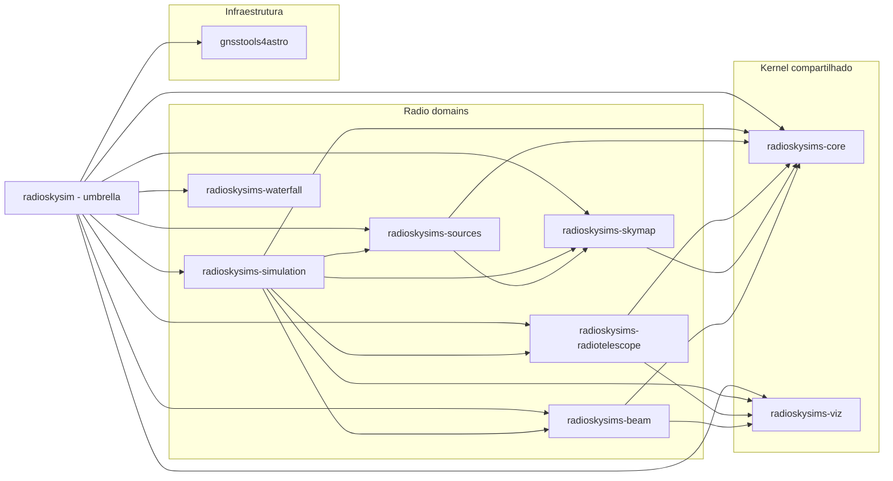
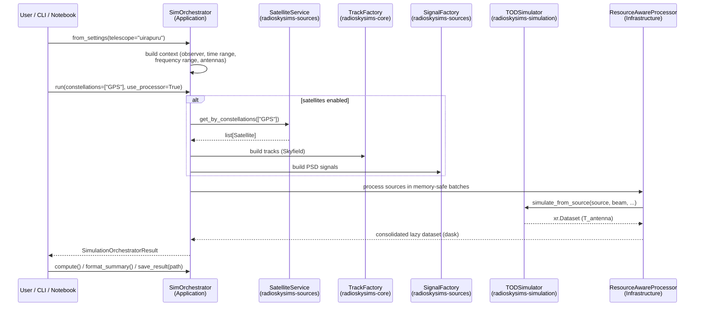
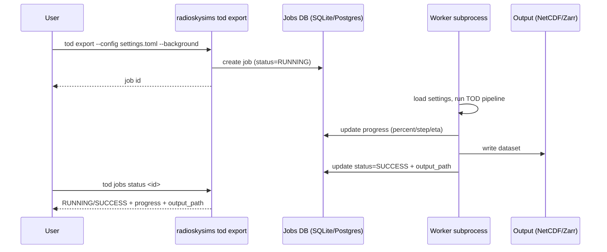

# Architecture, Diagrams & Sequence Flows

The canonical, continuously maintained architecture document is
{download}`architecture.md <../architecture.md>`. This page collects the
diagrams and sequence flows for the main use cases, matching the current
decoupled package layout.

## Layered architecture

RadioSkySim follows **Hexagonal (Ports & Adapters)**:

```mermaid
flowchart LR
    subgraph Interfaces["Interfaces (CLI / GUI / API)"]
        CLI[radioskysims · gnss4astro]
        GUI[Panel apps]
    end
    subgraph App["Application (use cases + ports)"]
        ORCH[SimOrchestrator / Services]
        PORTS[Ports / contracts]
    end
    subgraph Domain["Domain (entities + value objects)"]
        CORE[radioskysims-core]
        BEAM[radioskysims-beam]
        SKY[radioskysims-skymap]
        SRC[radioskysims-sources]
        SIM[radioskysims-simulation]
        WF[radioskysims-waterfall]
    end
    subgraph Infra["Infrastructure (adapters)"]
        DB[(PostgreSQL / SQLModel)]
        FILES[(HDF5 · Zarr · NetCDF · FITS)]
        SKYF[Skyfield · Healpy · PySM3 · HiPS]
        TAP[astroquery/TAP · SpaceTrack · Celestrak]
    end
    Interfaces --> App
    App --> Domain
    Domain --> Infra
    Infra -.implements.-> PORTS
    UMB[radioskysim - umbrella / composition root] --> Interfaces
```



## Package dependency graph



## Sequence: TOD simulation (main use case)



## Sequence: background job execution (planned)

```{note}
The background job runner (`tod export --background`, `jobs list/status/
cancel`) and the notebook `JobHandle`/widget are **planned** — see
`docs/tasks/tod_cli_background_tickets.md`. The diagram below captures the
target flow.
```



## Diagram assets

Existing diagram sources (editable, Mermaid/draw.io):

| File | Content |
|---|---|
| `docs/source/diagrams/radioskysim_ddd_architecture.mmd` | DDD class map (domain / application / infrastructure / external) |
| `docs/source/diagrams/radioskysim_sequence_diagram.mmd` | Simulation sequence (setup, satellites, signals) |
| `docs/source/diagrams/simulation_sequence_detailed.mmd` | Detailed TOD sequence |
| `docs/source/diagrams/skymap_domain_class.mmd`, `map_domain_class.mmd`, `map_domain_package.mmd` | SkyMap / domain maps |
| `docs/source/diagrams/radioskysim_architecture_uml.mmd` / `.drawio.svg` | Architecture UML |
| `docs/diagrams/architecture.mmd`, `uml_*.mmd`, `classes_and_sequence_*.mmd`, `usecase_*.mmd` | Historical UML + use-case diagrams |
| `docs/architecture.md` | Canonical architecture doc (Mermaid) |

## Class / ER diagrams (DB)

The persistence schema (tables, models and relationships) is documented in
{doc}`database`. Class-level diagrams for the beam, satellite and skymap
domains are in the assets listed above.

## How to update

1. Edit the `.mmd` source (Mermaid) or `.drawio` file.
2. Re-export static images (`.svg`/`.png`) if the build relies on them.
3. Validate the Mermaid syntax before committing (use the Mermaid validator
   and preview in the editor).
4. Keep `docs/architecture.md` in sync — it is the canonical reference.
