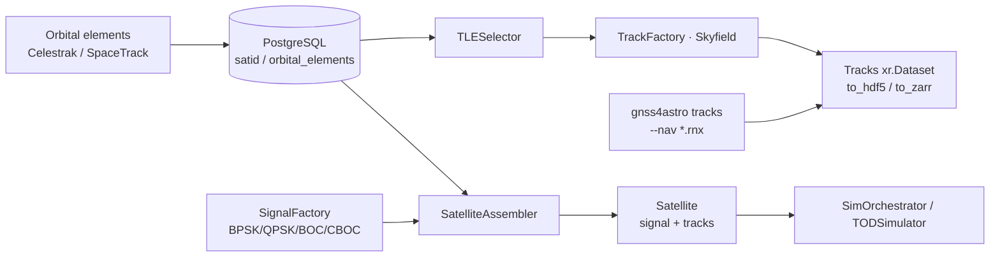

# Satellites (TLE / RINEX)

This page documents the pipeline that turns orbital elements into satellite
tracks and signals. The domain lives in `radioskysims-sources` (import
`radioskysims_sources`), tracks/geometry in `radioskysims-core`, and RINEX
tooling in `gnsstools4astro`.

## Pipeline overview



## Orbital elements (TLE)

### Downloaders

```python
from radioskysims_sources.infrastructure.external.satellite_downloader import (
    CelestrakClient,
    SpaceTrackClient,
)

# Celestrak (public)
df = CelestrakClient().fetch_sats()          # -> pandas.DataFrame

# SpaceTrack (credentials via ST_USER/ST_PWD or credentials.env)
st = SpaceTrackClient(epoch=None)
elements = st.fetch_elements_sync(norad_ids=[25544, ...])
st.clear_registry()
```

### Factory & selection

```python
from radioskysims_sources.domain.satellite import SatelliteFactory, TLESelector

factory = SatelliteFactory(repository=repo)
sats = factory.create_from_constellations(["GPS"])
# or factory.create_from_norad_ids([25544, ...])
```

`TLESelector.select(...)` picks the best orbital element for each satellite for
the simulation epoch.

## Tracks (Skyfield)

`TrackFactory` (in `radioskysims-core`) computes 3-D positions and geometry via
the Skyfield adapter:

```python
from radioskysims_core.domain.tracks.factory import TrackFactory

tf = TrackFactory(skyfield_data_path=None)
tracks_ds = tf.build(satellites_block, scheduler=None)   # -> xr.Dataset
```

The `Tracks` value object (`radioskysims_core.domain.tracks.models`) supports
`filter_by_satellite`, `filter_by_constellation`, `filter_by_time`,
`to_zarr(path)`, `to_hdf5(path)` and `get_chunks_info()`.

## Signals & PSD

`SignalFactory` builds power spectral densities from the modulation scheme
(lazy dask, Welch method):

```python
from radioskysims_sources.domain.signal import SignalFactory

signal_factory = SignalFactory(frequency_range=freq_range, signal_repo=repo)
signals = signal_factory.build(sats=None)   # lazy PSDs
```

Supported modulations: `BPSK(n)`, `QPSK(n)`, `BOC(m, n)`, `CBOC`.

The satellite ↔ signal assembly is done by `SatelliteAssembler`:

```python
from radioskysims_sources.domain.satellite import SatelliteAssembler

assembler = SatelliteAssembler(signal_factory=signal_factory, track_factory=track_factory)
assembled = assembler.build_signals(
    sats, recalculate=False, frequency_range=freq_range,
)   # -> SatelliteAssembled
```

### `signals.json`

Static signal metadata ships at `src/radioskysims/resources/satellites/
sat_signals.json` and is read by `SignalRepository` /
`SatelliteRepository._read_signals_json`. Override the path with the `[signals]
sat_signals` setting.

## Service layer

```python
from radioskysims_sources.application.services.satellite_service import SatelliteService

svc = SatelliteService(...)
svc.get_all()
svc.get_by_ids([25544, ...])
svc.get_by_constellations(["GPS", "GALILEO"])
svc.update_orbital_elements(...)
svc.update_from_celestrak()
```

`SimOrchestrator.run(constellations=[...])` calls this service internally to
fetch satellites before simulating TOD (see {doc}`simulation`).

## RINEX pipeline (gnss4astro)

`gnsstools4astro` handles GNSS/RINEX observations:

```bash
# Download RINEX observation/navigation files
gnss4astro download --station <st> --start <iso> --end <iso> --source rbmc --outdir data/

# Build satellite tracks from navigation files (positions/altitude/azimuth)
gnss4astro tracks --nav *.rnx --station <st> --lat --lon --height \
    --start --end --step 30 --min-alt 10 --out tracks.nc

# Estimate signal / bandwidth from observation files
gnss4astro signal --obs *.rnx --signal S1C --bandwidth-mhz 4 [--json]

# Sync exported signals into the project tree
gnss4astro sync-signals --target <path>
```

Programmatic use cases: `download_rinex`, `build_tracks`, `estimate_signal`
in `gnsstools4astro.application.use_cases`.

## Related notebooks

- `notebooks/04_generate_satellite_tracks.ipynb` — TLE → tracks end-to-end.
- `notebooks/03_satellite_signal_tracks_demo.ipynb` — satellites, PSDs, tracks.
- `notebooks/00_RADIOSKYSIM_COMPLETE_DEMO.ipynb` — full overview including
  satellites.
